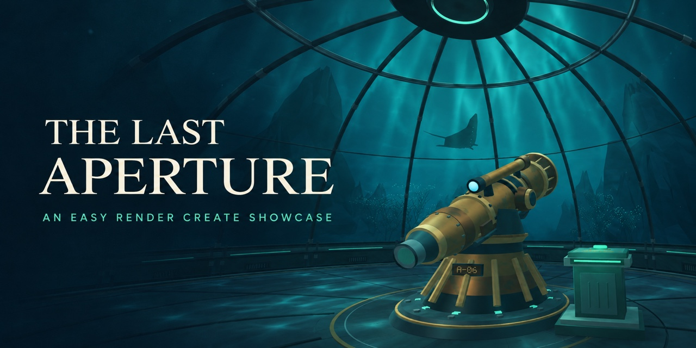

# The Last Aperture

Explore a quiet underwater observatory, restore its telescope, and watch the deep ocean light up beyond the glass dome. It's a short first-person browser game with one room, one switch, and one reveal.

This repository showcases a finished game built with Codex from a prompt generated by **Easy Render Create**, Arthur Benfica's skill for turning creative briefs into build prompts for scenes, games, and videos made with code.

**[Explore Easy Render Create](https://github.com/Benfic4rthur/easyRenderCreate)** · **[Read the original prompt](prompt.txt)**

## Play

[Download `index.html`](https://raw.githubusercontent.com/Benfic4rthur/the-last-aperture/main/index.html) and open it in Microsoft Edge or another desktop browser with WebGPU enabled. The game uses one self-contained HTML file with procedural geometry, lighting, particles, and audio. It needs no installation or external assets.

Use **WASD** to move, the **mouse** to look, and **E** to activate the amber switch. **Esc** pauses and **R** restarts.

## Performance

A 60-second scripted run in Microsoft Edge on an Apple M1 Pro at 1920 × 1080 recorded **3.14 ms average**, **6.23 ms at the 99th percentile**, and **8.78 ms maximum** using WebGPU timestamp queries.
